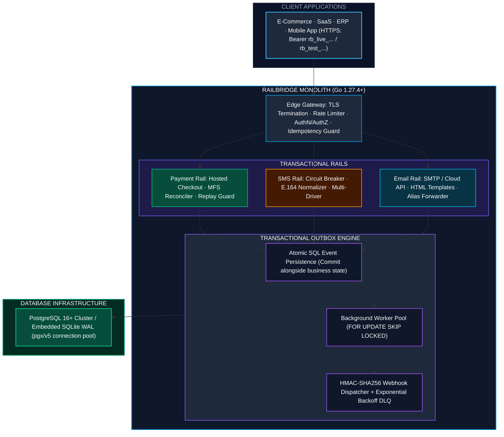
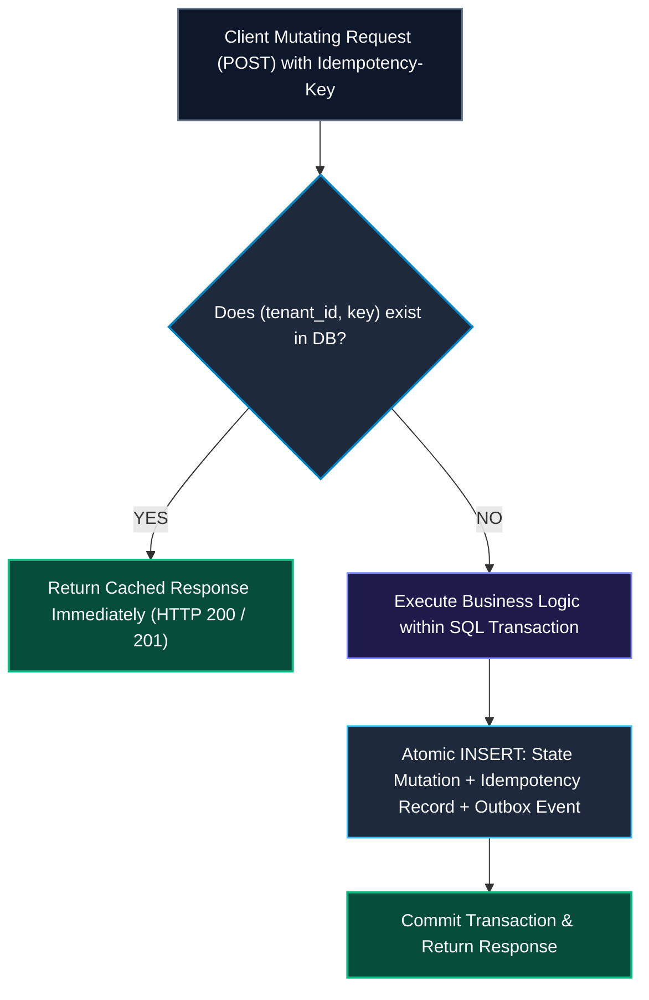
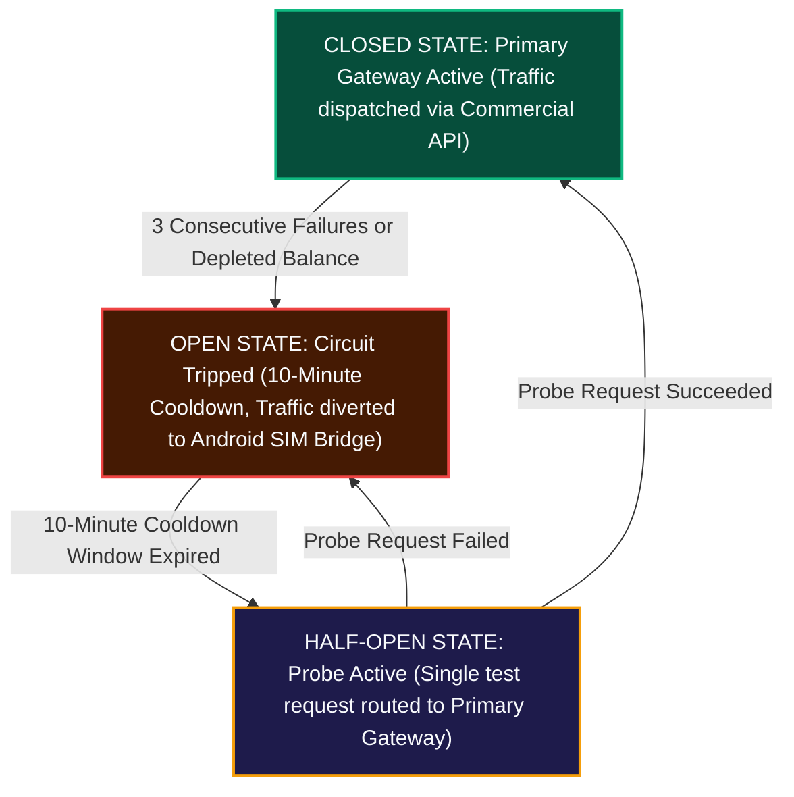

# Railbridge Architecture Specification

> **Modular Monolith, Multi-Tenant Isolation & Transactional Outbox Pattern**

## Reader Contract

- **Audience:** Backend engineers, infrastructure architects, and security reviewers evaluating or deploying Railbridge.
- **Assumed Knowledge:** Understanding of relational database transactions, ACID guarantees, HTTP/REST semantics, and symmetric cryptography.
- **Outcome:** After reading, you will understand the component boundaries, state machines, concurrency model, and cryptographic guarantees implemented across Railbridge.

---

## 1. System Topology

Railbridge is engineered as a **stateless modular monolith** compiled into a single static Go binary. All long-term state, idempotency records, message queues, and tenant credentials reside in an external relational database (PostgreSQL 16+ for production; embedded SQLite WAL for local development).



---

## 2. Strict Multi-Tenant Isolation

Railbridge guarantees strict isolation across multiple independent merchant applications sharing a single infrastructure deployment:

1. **Cryptographic Key Hashing:** API keys follow the format `rb_live_<32_hex_chars>` or `rb_test_<32_hex_chars>`. Plaintext keys are never stored. Only the SHA-256 hash is saved in the database:
   $$\text{api\_key\_hash} = \text{SHA-256}(\text{raw\_api\_key})$$
2. **Row-Level Boundary Enforcement:** Every table (`payment_sessions`, `message_logs`, `email_aliases`, `devices`, `mfs_unmatched_inbox`, `outbox_jobs`) includes a `tenant_id` foreign key. All SQL queries strictly scope filtering to `WHERE tenant_id = ?`.
3. **Secret Encryption at Rest:** Sensitive client secrets (such as tenant webhook secrets) are encrypted using authenticated **AES-256-GCM** with a 12-byte random nonce and a 32-byte master key injected via environment variable (`MASTER_ENCRYPTION_KEY`).

---

## 3. Idempotency Guard Mechanics

To prevent double-charging, duplicate OTP dispatch, or redundant email transmissions during network retries, all mutating endpoints (`POST`) enforce idempotency:



The database enforces this guarantee using composite unique constraints:
- `payment_sessions (tenant_id, idempotency_key)`
- `message_logs (tenant_id, rail, idempotency_key)`

---

## 4. The Transactional Outbox & Concurrency Model

### Why the Outbox Pattern is Mandatory
Directly calling external webhooks or third-party APIs inside an HTTP request handler creates dual-write vulnerabilities: if the database transaction commits but the network call times out (or vice versa), state diverges.

Railbridge solves this by appending an `outbox_jobs` row **in the exact same SQL transaction** that updates the payment or message status.

### PostgreSQL `FOR UPDATE SKIP LOCKED` Engine
When running multiple Railbridge worker replicas, background workers poll the outbox concurrently without race conditions or deadlocks:

```sql
SELECT id, tenant_id, job_type, payload, attempts, max_attempts
FROM outbox_jobs
WHERE status = 'pending' AND next_run_at <= NOW()
ORDER BY next_run_at ASC
LIMIT 10
FOR UPDATE SKIP LOCKED;
```

**Mechanical Properties:**
- `FOR UPDATE` places exclusive row-level locks on the returned records.
- `SKIP LOCKED` instructs PostgreSQL to bypass any rows currently locked by other worker nodes, eliminating lock contention and queue stalls.
- Once processed, the job status updates to `completed`.
- If an unhandled crash occurs, the connection terminates and PostgreSQL automatically releases the row lock for subsequent workers.

---

## 5. Webhook Security Specification

Outbound webhook notifications dispatched by Railbridge are cryptographically signed to ensure authenticity and defend against replay attacks:

### Header Wire Format
```http
POST /webhooks/railbridge HTTP/1.1
Host: client-store.com
Content-Type: application/json
X-Railbridge-Event: payment.verified
X-Railbridge-Delivery: dlv_01J9X7K2M4A1B2C3D4E5
X-Railbridge-Signature: t=1763719200,v1=5257a869e7ecebeda32affa62cdca3fa51cad7e77a0e56ff536d0ce8e108d8bd
```

### Signature Computation & Verification
1. Payload Construction:
   $$\text{signed\_string} = t + \text{"."} + \text{raw\_body}$$
2. Signature Generation:
   $$\text{expected\_sig} = \text{HMAC-SHA256}(\text{webhook\_secret}, \text{signed\_string})$$
3. Verification Requirements:
   - Constant-time byte comparison (`crypto/subtle.ConstantTimeCompare`).
   - Clock drift rejection: reject if $| \text{now} - t | > 300\text{ seconds}$.

---

## 6. Failure Modes & Circuit Breaker State Machine

For SMS and email dispatches, Railbridge implements an automated circuit breaker to prevent cascading failures:


