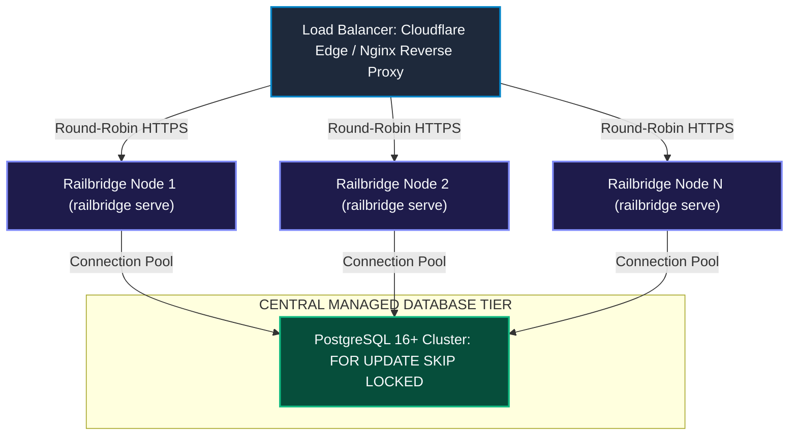

# Railbridge Production Operations & Deployment Runbook

> **Alwaysdata.net, Docker Containerization & Scaled Multi-Node Clustering**

## Reader Contract

- **Audience:** Site reliability engineers (SREs), system administrators, and developers deploying Railbridge to production.
- **Assumed Knowledge:** Basic Linux shell operations, systemd/process managers, Docker, and PostgreSQL connection pooling.
- **Outcome:** You will be able to compile the CGO-free binary, configure production environment variables, provision database migrations, and deploy Railbridge on Alwaysdata or any Linux VPS cluster.

---

## 1. Environment Variable Specification

| Variable | Type | Default | Description |
|---|---|---|---|
| `APP_ENV` | String | `development` | Environment mode (`development`, `staging`, `production`). |
| `APP_BASE_URL` | URL | `http://localhost:8080` | Publicly accessible HTTPS base URL (used to generate checkout links). |
| `IP` | IP | `0.0.0.0` | Network binding interface. Alwaysdata injects this dynamically. |
| `PORT` | Integer | `8080` | Network listening port. Alwaysdata injects this dynamically. |
| `DATABASE_URL` | URI | SQLite WAL | PostgreSQL connection URI or SQLite file path. |
| `MASTER_ENCRYPTION_KEY` | 64 Hex | None | 32-byte secret key used for AES-256-GCM tenant encryption. |
| `EMAIL_DRIVER` | String | `smtp` | Primary email driver (`smtp`, `resend`, `mock`). |
| `SMTP_HOST` | Hostname | None | Outbound SMTP server hostname. |
| `SMTP_PORT` | Integer | `587` | Outbound SMTP server port. |
| `SMTP_USER` | String | None | SMTP authentication username. |
| `SMTP_PASS` | String | None | SMTP authentication password. |
| `SMS_PRIMARY_DRIVER` | String | `android_bridge` | Primary SMS driver (`greenweb`, `android_bridge`). |
| `SMS_FALLBACK_DRIVER` | String | `greenweb` | Failover SMS driver when circuit breaker trips. |
| `GREENWEB_API_TOKEN` | String | None | Commercial API token for Greenweb SMS gateway. |

---

## 2. Deploying to Alwaysdata.net

Alwaysdata provides native support for persistent background daemons via its "User Program" runtime.

### Step 1: Compile Static CGO-Free Binary
Run from your local development workstation (Windows, macOS, or Linux):
```bash
CGO_ENABLED=0 GOOS=linux GOARCH=amd64 go build -ldflags="-s -w" -o railbridge ./cmd/railbridge
```

### Step 2: Upload Artifacts
Transfer the static binary and your `.env` configuration file to Alwaysdata via SFTP/SCP:
```bash
scp railbridge .env railbridge@ssh-railbridge.alwaysdata.net:/home/railbridge/app/
```

### Step 3: Alwaysdata Admin Console Setup
1. Open **Web > Sites > Add a site**.
2. **Addresses:** `railbridge.alwaysdata.net` (and later add `api.railbridge.swe-labs.com`).
3. **Type:** Select **User program**.
4. **Command:** `/home/railbridge/app/railbridge serve`
5. **Working directory:** `/home/railbridge/app`
6. Alwaysdata automatically sets `$IP` and `$PORT` in the process environment.
7. Click **Submit**. Alwaysdata provisions Let's Encrypt SSL/TLS certificates automatically.

---

## 3. Containerized Deployment (Docker)

### Multi-Stage Dockerfile
```dockerfile
# Build Stage
FROM golang:1.27.4-alpine AS builder
WORKDIR /src
COPY go.mod go.sum ./
RUN go mod download
COPY . .
RUN CGO_ENABLED=0 GOOS=linux GOARCH=amd64 go build -ldflags="-s -w" -o /bin/railbridge ./cmd/railbridge

# Minimal Runtime Stage
FROM gcr.io/distroless/static-debian12:nonroot
WORKDIR /app
COPY --from=builder /bin/railbridge /app/railbridge
EXPOSE 8080
USER nonroot:nonroot
ENTRYPOINT ["/app/railbridge", "serve"]
```

### Running the Container
```bash
docker run -d \
  --name railbridge \
  --restart unless-stopped \
  -p 8080:8080 \
  --env-file .env \
  ghcr.io/swe-labs/railbridge:v1.0.0
```

---

## 4. Scaling Across Multiple Server Replicas

Because Railbridge is entirely stateless, scaling horizontally requires zero architectural changes:



1. Run multiple identical Railbridge container instances behind a round-robin load balancer.
2. All instances connect to the same central PostgreSQL database.
3. Outbox worker goroutines query the database with `FOR UPDATE SKIP LOCKED`. PostgreSQL row-level locks guarantee that no two worker nodes ever pick up the same job.

---

## 5. Health Probes & Monitoring

### Liveness Probe (`GET /healthz`)
Verifies that the HTTP process is actively receiving requests:
```bash
curl -i http://localhost:8080/healthz
# HTTP/1.1 200 OK
# {"env":"production","status":"pass","time":"2026-11-21T18:00:00Z","version":"v1.0.0"}
```

### Readiness Probe (`GET /readyz`)
Verifies that the database pool is active, reachable, and capable of executing queries:
```bash
curl -i http://localhost:8080/readyz
# HTTP/1.1 200 OK
# {"database":"connected","dialect":"postgres","status":"ready"}
```
