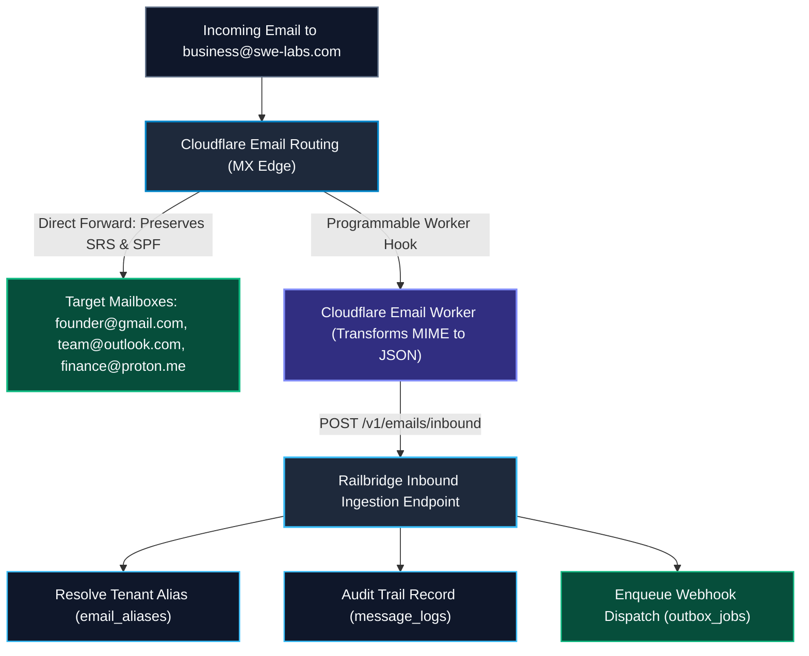

# Custom Domain Email Routing Specification

> **Virtual Inbound Email Aliasing, Cloudflare Routing & Outbound SMTP Setup**

## Reader Contract

- **Audience:** DevOps engineers and domain administrators configuring branded email routing without maintaining dedicated mail transfer agents (MTAs).
- **Assumed Knowledge:** DNS management (MX, TXT, SPF, DKIM) and cloud serverless workers.
- **Outcome:** You will be able to route any address on your custom domain (e.g. `business@swe-labs.com`) to a personal inbox (Gmail, Outlook, Proton, Yahoo) and send replies directly from that branded address.

---

## 1. High-Level Flow



---

## 2. DNS Configuration (Cloudflare DNS)

Configure your custom domain (`swe-labs.com`) with the following DNS records:

### 2.1 Mail Exchange (MX) Records
| Type | Host | Points To | Priority |
|---|---|---|---|
| MX | `@` | `mx1.cloudflare.net` | 10 |
| MX | `@` | `mx2.cloudflare.net` | 20 |
| MX | `@` | `mx3.cloudflare.net` | 30 |

### 2.2 Sender Policy Framework (SPF) TXT Record
Authorize both Cloudflare Email Routing and your outbound SMTP provider (Alwaysdata, Resend, or Brevo):
```text
v=spf1 include:_spf.mx.cloudflare.net include:alwaysdata.com include:resend.com ~all
```

---

## 3. Cloudflare Email Worker Script

Deploy this worker in your Cloudflare dashboard to intercept incoming emails and relay them to Railbridge:

```typescript
export default {
  async email(message, env, ctx) {
    const rawEmail = await new Response(message.raw).text();
    
    const payload = {
      from: message.from,
      to: message.to,
      subject: message.headers.get("subject") || "(No Subject)",
      text: rawEmail,
    };

    const railbridgeEndpoint = "https://railbridge.alwaysdata.net/v1/emails/inbound";

    const response = await fetch(railbridgeEndpoint, {
      method: "POST",
      headers: {
        "Content-Type": "application/json",
        "User-Agent": "Cloudflare-Email-Worker/v1.0.0",
      },
      body: JSON.stringify(payload),
    });

    if (!response.ok) {
      console.error(`Railbridge webhook returned status: ${response.status}`);
      // Fallback: forward directly to safety inbox if webhook fails
      await message.forward("fallback@swe-labs.com");
      return;
    }

    // Forward original message preserving headers and SPF
    await message.forward("founder@gmail.com");
  }
};
```

---

## 4. Sending Outbound Replies from Personal Inboxes (Gmail / Outlook)

Recipients should see replies originating directly from `business@swe-labs.com` rather than your personal address:

### Setup in Gmail
1. Open Gmail **Settings > Accounts and Import > Send mail as**.
2. Click **Add another email address**.
3. **Name:** `SWE Labs Business`
4. **Email address:** `business@swe-labs.com`
5. Uncheck **Treat as an alias**. Click **Next Step**.
6. **SMTP Server:** `smtp-railbridge.alwaysdata.net` (or `smtp.resend.com`).
7. **Port:** `587` (Secured connection using TLS).
8. **Username:** `noreply@swe-labs.com` (your Alwaysdata/Resend SMTP username).
9. **Password:** `<your_smtp_password>`.
10. Click **Add Account** and enter the confirmation verification code sent to `business@swe-labs.com`.
