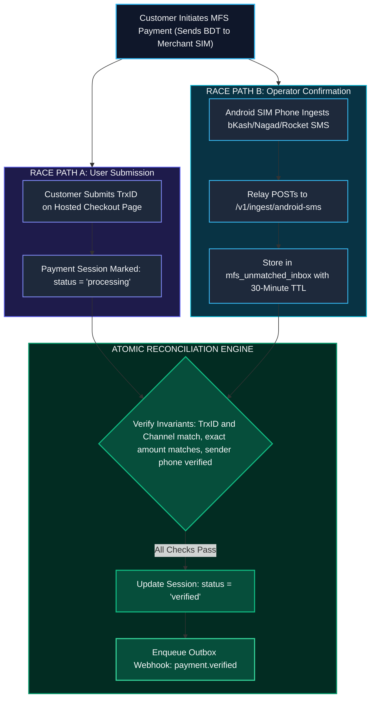

# Mobile Financial Services (MFS) Integration Guide

> **bKash, Nagad & Rocket Automated Personal/Agent Reconciliation Engine**

## Reader Contract

- **Audience:** Integration engineers and Android hardware operators deploying automated payment reconciliation.
- **Assumed Knowledge:** Basic familiarity with Bangladesh Mobile Financial Services (MFS), Android telephony intents, and regular expressions.
- **Outcome:** You will be able to configure an Android phone with a Bangladesh SIM card, connect it securely to Railbridge via device tokens, and automatically verify incoming customer payments without manual oversight.

---

## 1. MFS Automation Mechanics: Personal vs. Tokenized Merchant

Bangladesh MFS operations follow two models:

| Dimension | Mode 1: Commercial Merchant API | Mode 2: Android SIM Bridge Automation |
|---|---|---|
| **Prerequisites** | Formal trade license, merchant bank account, corporate aggregator contract. | Regular personal or agent BD SIM card (GP, Robi, Banglalink, Teletalk). |
| **API Cost** | 1.5% to 2.5% transaction fee charged per checkout. | Zero transaction fees. Standard SMS bundle costs only (~0.05 BDT/SMS). |
| **Payment Flow** | Tokenized redirect to official bKash/Nagad checkout gateway. | Customer executes standard "Send Money" to the merchant's SIM number. |
| **Verification** | Webhook direct from MFS aggregator servers. | Railbridge Android SIM Bridge reads operator confirmation SMS and verifies TrxID. |

---

## 2. Two-Way Asynchronous Reconciliation Architecture

When a customer executes "Send Money" on their mobile app, a race condition naturally exists:
- **Event A:** The customer enters their TrxID on the hosted checkout page.
- **Event B:** The merchant's Android phone receives the official operator confirmation SMS and forwards it to Railbridge.

Railbridge guarantees deterministic reconciliation regardless of which event arrives first:



---

## 3. Operator SMS Regex Parsing Patterns

Railbridge utilizes isolated regex parsers in `internal/mfs/parser.go`. These patterns have been tested against actual operator templates:

### 3.1 bKash (Shortcode `16247` or `bKash`)
- **Template (Receive Money):**
  `You have received Tk 150.00 from 01812345678. Fee Tk 0.00. Balance Tk 5,230.12. TrxID 9K72B8X9M1 at 21/11/2026 14:30`
- **Regex:**
  `(?i)You have received (?:deposit of )?Tk\s*([0-9,]+\.[0-9]{2}) from ([0-9+]+)\..*?TrxID\s+([A-Z0-9]+)`
- **Extracted Fields:**
  - Amount: `150.00` $\rightarrow$ stored as `15000` minor units.
  - Sender: `+8801812345678` (normalized to E.164).
  - TrxID: `9K72B8X9M1` (converted to uppercase).

### 3.2 Nagad (Shortcode `16167` or `Nagad`)
- **Template:**
  `Money Received. Amount: Tk 250.00. Sender: 01712345678. TxnID: 7K9B12XA. Balance: Tk 1,200.00. Date: 21/11/2026 14:32`
- **Regex:**
  `(?i)(?:Money|Payment) Received\.\s*Amount:\s*Tk\s*([0-9,]+\.[0-9]{2})\.\s*Sender:\s*([0-9+]+)\.\s*TxnID:\s*([A-Z0-9]+)`

### 3.3 Rocket (Shortcode `16216` or `Rocket`)
- **Template:**
  `Cash In Tk 100.00 from 01812345678 successful. TxnId: RK8812A. Balance Tk 500.00`
- **Regex:**
  `(?i)(?:Cash In|Received) Tk\s*([0-9,]+\.[0-9]{2}) from ([0-9+]+) successful\.\s*TxnId:\s*([A-Z0-9]+)`

---

## 4. Android SIM Bridge Hardware Setup

### Required Phone Specifications
- **Operating System:** Android 8.0 (Oreo) or later.
- **Hardware:** Any budget Android device with an active SIM tray.
- **Connectivity:** Reliable Wi-Fi or persistent 4G cellular data connection. Battery saver optimizations must be disabled for the forwarder app.

### Authentication & Registration
1. Generate an isolated device token for the tenant:
   ```bash
   # Token format: rb_dev_<32_random_hex_chars>
   rb_dev_warehouse_node_7f8a9b2c4e1d0a9f
   ```
2. Register the device in Railbridge:
   ```sql
   INSERT INTO devices (id, tenant_id, device_name, device_token_hash, device_secret_encrypted, phone_numbers)
   VALUES (
     gen_random_uuid(),
     '<tenant_id>',
     'Warehouse Phone Node 1',
     sha256('rb_dev_warehouse_node_7f8a9b2c4e1d0a9f'),
     '<encrypted_secret>',
     '["+8801812345678"]'::jsonb
   );
   ```

### Heartbeat & Auto-Degradation Rules
- **Ping Interval:** The device posts to `POST /v1/ingest/android-ping` every **30 seconds**.
- **Offline Threshold:** If Railbridge receives no ping for **90 seconds**, the device status marks `offline`.
- **Checkout Degradation:** The hosted checkout page automatically hides personal bKash/Nagad options or marks them as degraded when no paired device is online, preventing customer funds from being sent to unmonitored SIM cards.
